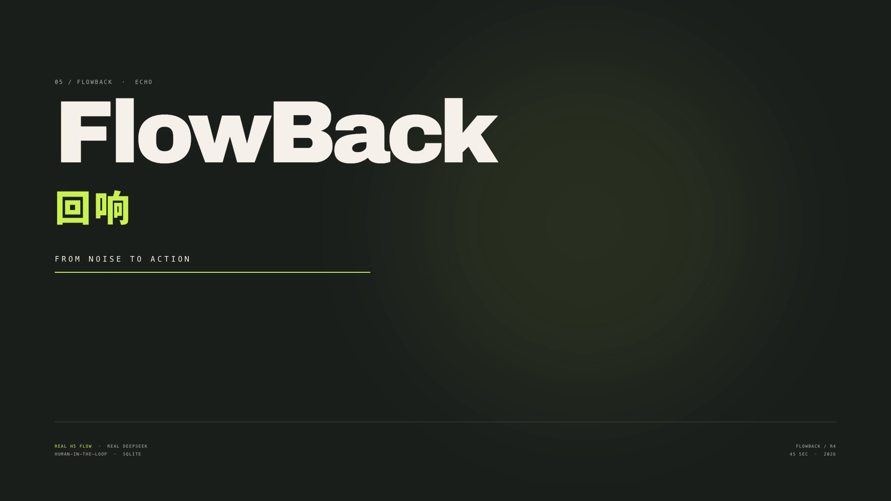
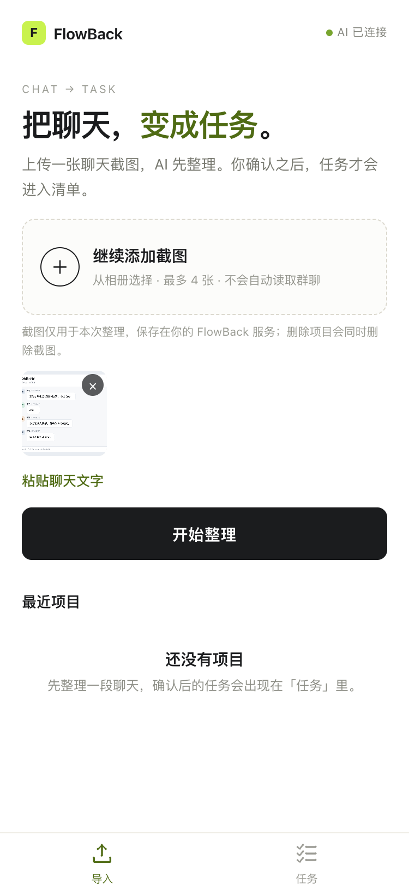
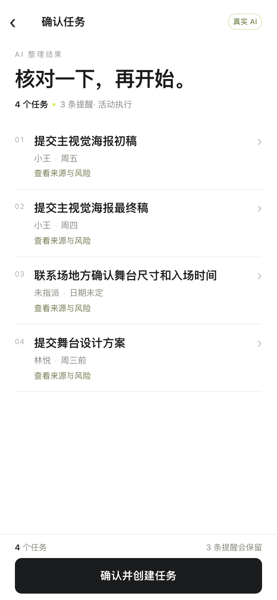
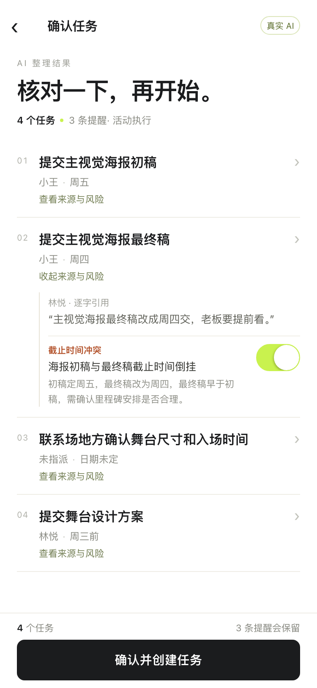
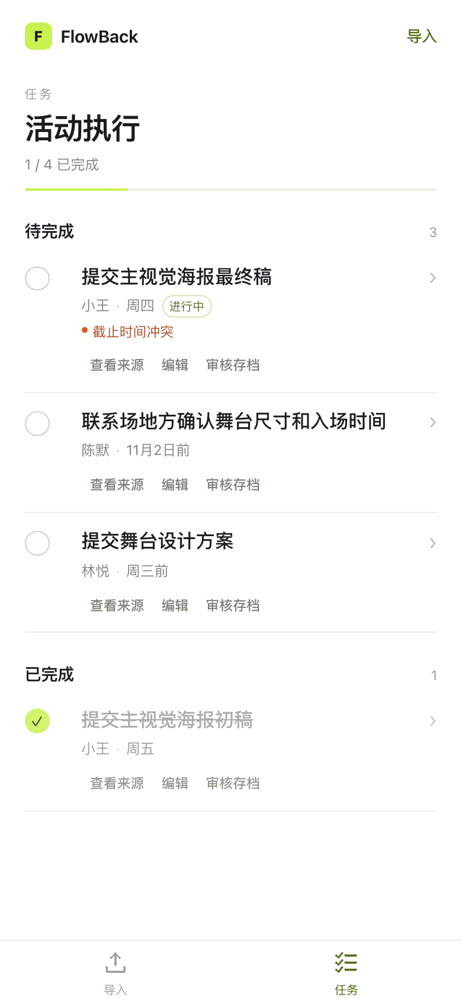
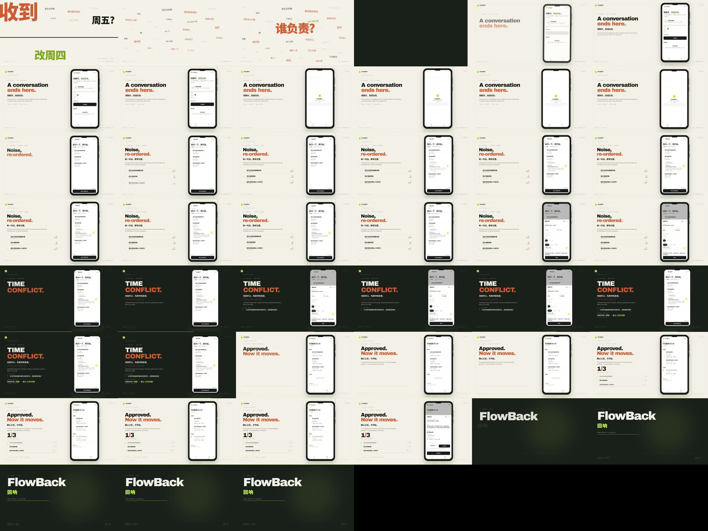
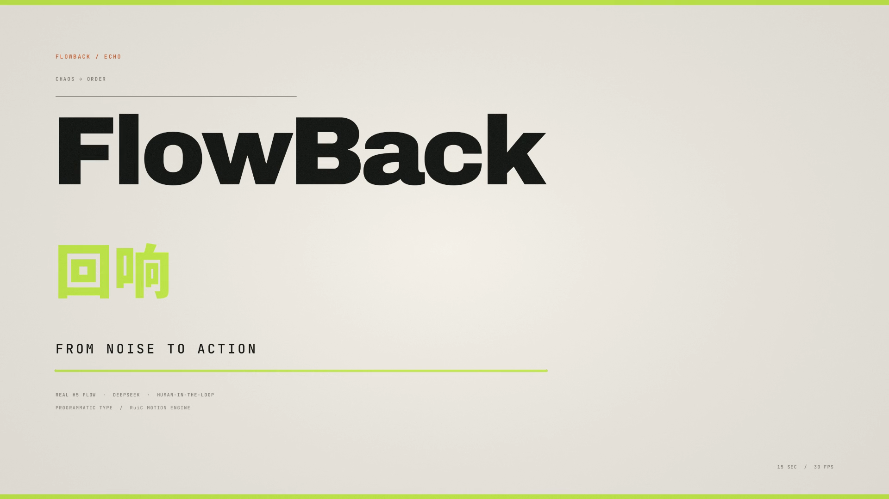
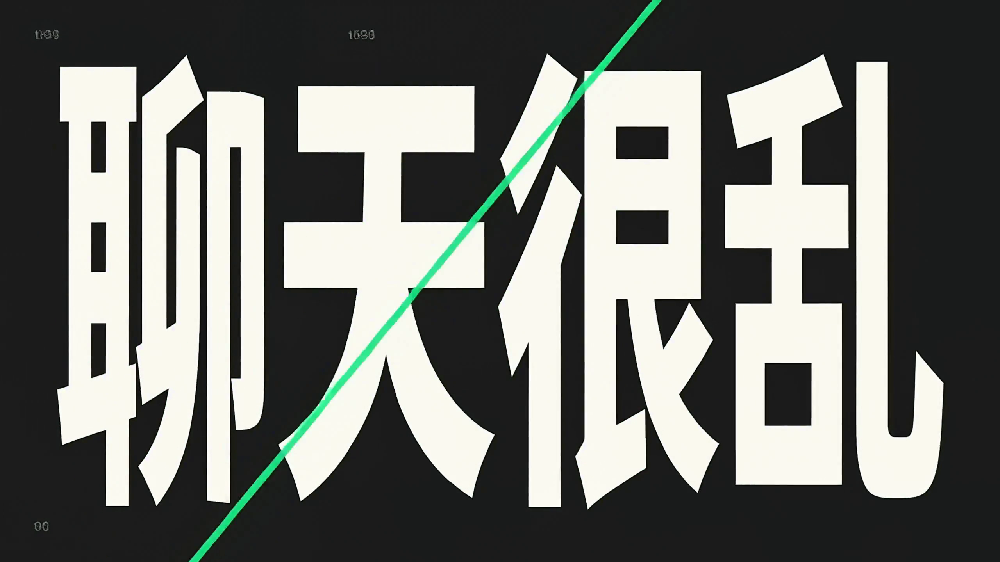
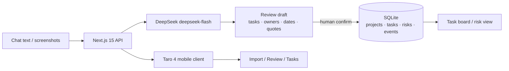

<p align="center">
  
</p>

<h1 align="center">FlowBack</h1>

<p align="center">
  <strong>Turn a conversation into reviewable, executable, traceable work.</strong><br/>
  <sub>From noise to action — with a human in the loop.</sub>
</p>

<p align="center">
  
  
  
  
  
  
  
</p>

<p align="center">
  <a href="README.md">中文</a> ·
  <strong>English</strong> ·
  <a href="README.ja.md">日本語</a>
</p>

<p align="center"><a href="https://cdn.jsdelivr.net/gh/YanKaFei/flowback@main/videos/r4/FlowBack_Demo_45s.mp4"><strong>▶ 45s film</strong></a> &nbsp;·&nbsp; <a href="https://cdn.jsdelivr.net/gh/YanKaFei/flowback@main/videos/r4/FlowBack_Typography_15s_web.mp4"><strong>▶ 15s typography</strong></a> &nbsp;·&nbsp; <a href="https://cdn.jsdelivr.net/gh/YanKaFei/flowback@main/videos/%E5%8A%A8%E6%80%81%E5%AD%97%E4%BD%93%E9%87%8D%E6%9E%84.mp4"><strong>▶ Dynamic Type Refactor</strong></a></p>


---

> **Where the chat ends, the work begins.**
>
> FlowBack reads chat text or screenshots and extracts tasks, owners, due dates and verbatim source quotes. The model produces a draft; **a human confirms it before anything is written to the database**. FlowBack also makes the gaps visible: owner gaps, date conflicts, missing deadlines and unconfirmed decisions.

This is not a “summarize the chat” demo. It is a complete, auditable workflow:

```text
CHAT  →  AI DRAFT  →  HUMAN REVIEW  →  TASKS  →  STATE
         candidates      you decide      SQLite     refresh-safe
```

### Why FlowBack

| A generic AI summary | FlowBack |
|---|---|
| Produces plausible prose | Produces task objects with source quotes |
| Writes over your data | Creates candidates; writes only after confirmation |
| Hides “nobody owns this” | Makes owner gaps, date conflicts and unconfirmed decisions visible risks |
| A demo state that disappears on refresh | SQLite + task events; the state persists |
| One screen only | Next.js admin + Taro mobile client, one API |

### Real evidence

| Check | Result |
|---|---|
| DeepSeek | `deepseek-flash`, JSON mode, server-side key only |
| R2 real fixtures | **7/7 PASS**; task recall, precision and F1 **100%**; quote verification **100%** |
| Regression tests | **11 test files / 78 tests** passing |
| Mobile flow | real screenshot → DeepSeek → review edit → confirm → complete → refresh |
| WeChat mini program | `build:weapp` passes; **native device still PENDING** (no AppID / HTTPS domain) |
| R4 films | 45s main + 15s typography, both actually rendered and FFprobe-checked |

> [!IMPORTANT]
> **Evidence boundary:** the mobile footage is a real **Taro H5 preview flow**, not a WeChat-native device recording. H5 screenshots are not a substitute for device evidence; the R3 WeChat experience build is still PENDING.

### Product in four moves

<table>
<tr>
<td width="25%" valign="top"><strong>01 · IMPORT</strong><br/><sub>Bring the mess in</sub><br/><br/>Up to four screenshots, or paste chat text. Screenshots are used only for this review and are deleted with the project.</td>
<td width="25%" valign="top"><strong>02 · DRAFT</strong><br/><sub>Let the model do the dirty work</sub><br/><br/>DeepSeek extracts tasks, owners, dates and quotes; unsupported fields are downgraded or marked for confirmation.</td>
<td width="25%" valign="top"><strong>03 · REVIEW</strong><br/><sub>The human keeps the final call</sub><br/><br/>Edit owners, dates and status. Date inversions, owner gaps and unconfirmed decisions surface here.</td>
<td width="25%" valign="top"><strong>04 · ACT</strong><br/><sub>Only then does work begin</sub><br/><br/>Tasks enter the SQLite board. Complete a task, resolve or reopen a risk; state survives refresh.</td>
</tr>
</table>

### Screens

<p align="center">
  <em>Taro H5 preview · 390px · real screenshot import and review data</em>
</p>

<table align="center">
<tr>
<td align="center"><br/><sub><b>Import</b><br/>screenshot / text</sub></td>
<td align="center"><br/><sub><b>Review</b><br/>task · owner · due</sub></td>
<td align="center"><br/><sub><b>Source &amp; risk</b><br/>verbatim quote · date conflict</sub></td>
<td align="center"><br/><sub><b>Tasks</b><br/>complete · persist</sub></td>
</tr>
</table>

<p align="center"><sub>H5 preview, not a WeChat-native device capture. Real-device validation still needs an AppID and a trusted HTTPS domain.</sub></p>

### R4 films

**FlowBack — From Noise to Action** · 45s · 1920×1080 · 30fps · H.264/AAC

[](videos/r4/FlowBack_Demo_45s.mp4)

[▶ Watch the 45s film](https://cdn.jsdelivr.net/gh/YanKaFei/flowback@main/videos/r4/FlowBack_Demo_45s.mp4) · [Download MP4](videos/r4/FlowBack_Demo_45s.mp4) · [Production report](videos/r4/R4-PRODUCTION-REPORT.md) · [Storyboard](videos/r4/storyboard/storyboard.md)

**CHAOS → ORDER** · 15s · pure typography / programmatic motion · 1920×1080 · 30fps

[](videos/r4/FlowBack_Typography_15s.mp4)

[▶ Watch the 15s typography film](https://cdn.jsdelivr.net/gh/YanKaFei/flowback@main/videos/r4/FlowBack_Typography_15s_web.mp4) · [Download master](videos/r4/FlowBack_Typography_15s.mp4)

Both films share one visual system: warm paper, graphite, signal green and a restrained orange. The 45s film places the real H5 flow inside a phone composition; the 15s typography film is fully programmatic, with exact Chinese brand lettering and `FlowBack` set in real type — never guessed by a video model.

### Archive

**Dynamic Type Refactor** · 15.08s · 2560×1440 · 24fps · H.264/AAC

<a href="videos/动态字体重构.mp4"></a>

[▶ Watch Dynamic Type Refactor](https://cdn.jsdelivr.net/gh/YanKaFei/flowback@main/videos/%E5%8A%A8%E6%80%81%E5%AD%97%E4%BD%93%E9%87%8D%E6%9E%84.mp4) · [Download MP4](videos/动态字体重构.mp4)

An additional kinetic-type piece supplied separately. It keeps its original filename and is not part of the R4 acceptance pair.

### Architecture



- **Backend:** Next.js 15 App Router, TypeScript strict, Zod, `node:sqlite`.
- **Mobile:** Taro 4 + React 18 + TypeScript; exactly two primary tabs: **Import / Tasks**.
- **Identity:** bearer sessions; only SHA-256 token hashes in the database; owner checks on projects, sources, tasks, risks and screenshots.
- **Security:** DeepSeek key server-side only; `FLOWBACK_LOCAL_TOKEN` HttpOnly cookie; authenticated screenshot access; logs redact bearer tokens, codes, openids and image data URLs.
- **Data:** `projects / sources / extractions / tasks / risks / task_events / users / sessions`; deleting a project cascades database rows and the screenshot directory.

### Quick start

```bash
git clone https://github.com/YanKaFei/flowback.git
cd flowback
npm install
cp .env.example .env.local
# DEEPSEEK_API_KEY=...
# FLOWBACK_LOCAL_TOKEN=<openssl rand -base64 32>
# FLOWBACK_DEV_AUTH=1   # local development only
npm run dev
```

Open <http://127.0.0.1:4317>.

```bash
npm run check      # lint + typecheck + 78 tests + production build
```

Without `DEEPSEEK_API_KEY`, the app enters an **explicitly labelled sample mode**; rule-based output is never disguised as AI output.

### WeChat mini program

```bash
cd miniapp
npm install
npm run build:weapp     # dist/, about 432 KB
npm run dev:h5          # 4318, mobile browser preview only
```

| Item | Status |
|---|---|
| Real DeepSeek + H5 loop | **PASS** |
| WeChat `build:weapp` | **PASS** |
| WeChat native device | **PENDING** — no AppID / trusted HTTPS / request domain |
| Experience-version sharing | **NOT READY** |

External steps: configure `WECHAT_APP_ID` / `WECHAT_APP_SECRET`; deploy trusted HTTPS; whitelist the domain for WeChat requests; complete the privacy guide; run a real-device check in WeChat DevTools.

### R4 production

| Layer | Used |
|---|---|
| Edit / render | **Huashu Motion 0.3.1** — `runtime/om-engine.js` video seek/extract, `OM.music` / `OM.sfx`, `om sound`, `om render` |
| Programmatic type | **RuiC Motion** — `mg/core.py` `text` / `text_slices` / `text_outline`, `mg/fonts.fit_size`, `mg/dsp` score |
| Kinetic-type narrative | **Huashu Art Motion** `y5_kinetic_type` grammar — `slam / rise / marker`, one focus per beat, colour chapters |
| Material | real H5 recording + `acceptance/images/07-chat-conflict.png`; no commercial music, no H3-generated media |
| Licences | all three Motion repositories are MIT; fonts are OFL 1.1; details in the production report |

### Docs

- [R3 WeChat device report](acceptance/R3-WECHAT-DEVICE.md) — security, identity isolation, pending items
- [R2 real acceptance](acceptance/REPORT.md) — 7/7 fixtures, quote verification, real calls
- [R4 production report](videos/r4/R4-PRODUCTION-REPORT.md) — tools, code, FFprobe, QA
- [Mobile acceptance](acceptance/MOBILE-FINAL.md)
- [Mini program notes](miniapp/README.md)

### One sentence

**AI can propose the work; only a human decides whether it becomes work.**

## Credits & licences

- **Huashu Motion** — MIT · [github.com/alchaincyf/huashu-motion](https://github.com/alchaincyf/huashu-motion)
- **RuiC Motion** — MIT · [github.com/HRuiCcc/RuiC-motion-reel](https://github.com/HRuiCcc/RuiC-motion-reel)
- **Huashu Art Motion** — MIT · [github.com/alchaincyf/huashu-art-motion](https://github.com/alchaincyf/huashu-art-motion)
- Bundled Latin/CJK fonts — SIL OFL 1.1, as listed in each source tree.
- FlowBack product screenshots and H5 footage come from this project; WeChat-native status is stated above.

<p align="center">
  <sub>Built with <strong>DeepSeek Harness</strong> · deepseek-flash · Next.js · Taro · SQLite</sub><br/>
  <sub>NOISE → STRUCTURE → ACTION</sub>
</p>
