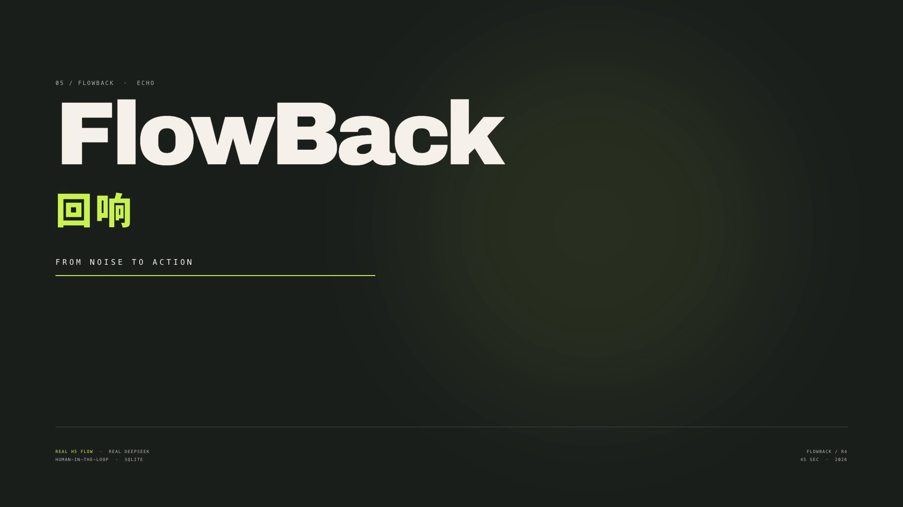
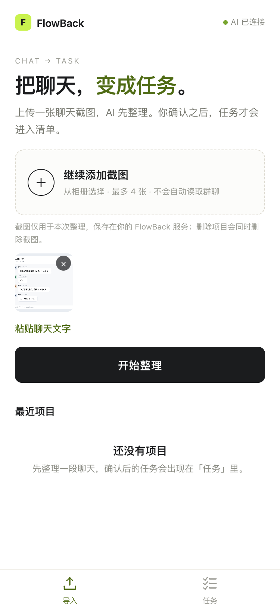
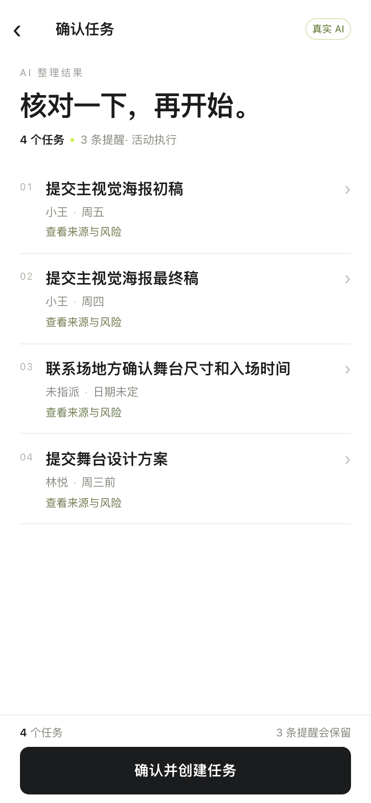
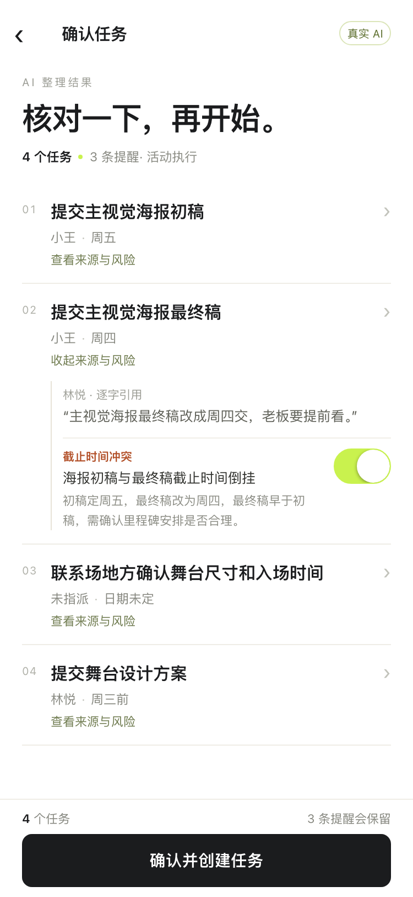
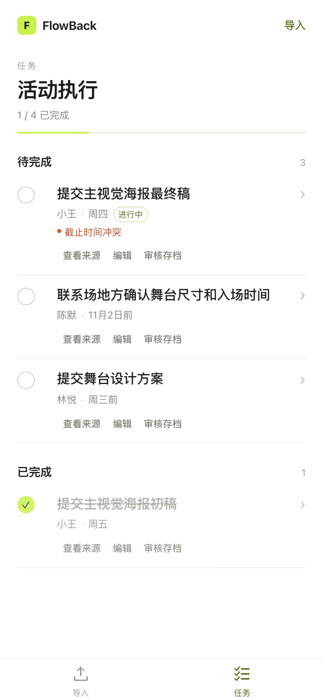
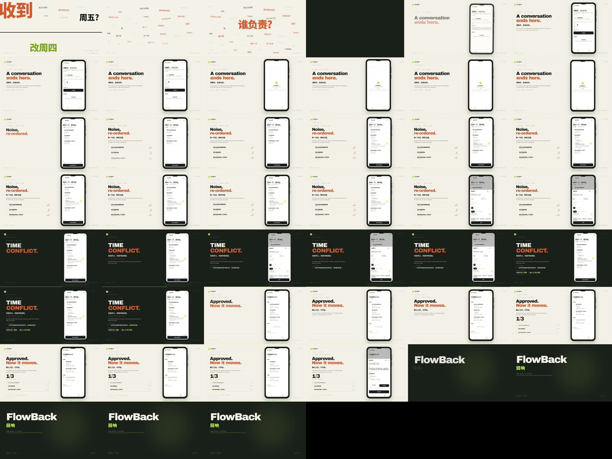
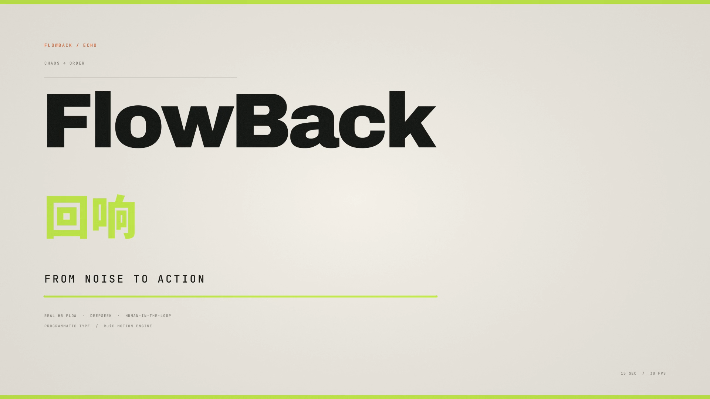
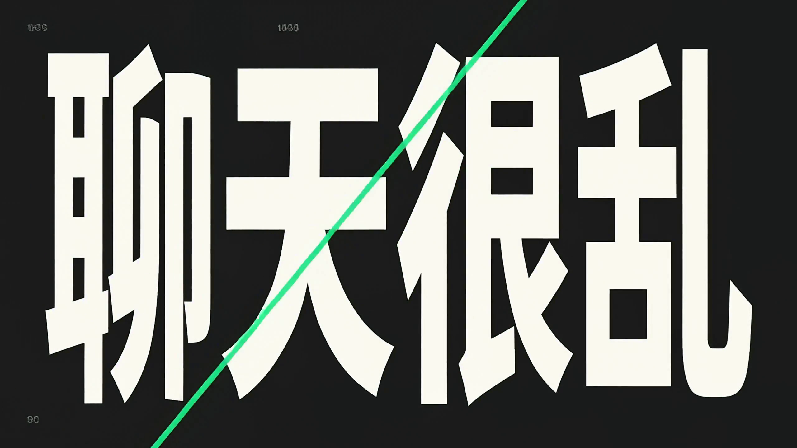
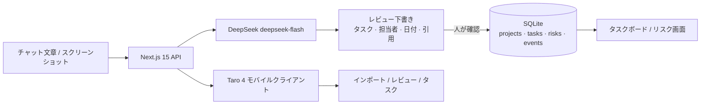

<p align="center">
  
</p>

<h1 align="center">FlowBack · 回响</h1>

<p align="center">
  <strong>会話を、レビュー可能で実行可能、追跡可能な仕事へ。</strong><br/>
  <sub>ノイズからアクションへ。人の判断を、常に回路の中に。</sub>
</p>

<p align="center">
  
  
  
  
  
  
  
</p>

<p align="center">
  <a href="README.md">中文</a> ·
  <a href="README.en.md">English</a> ·
  <strong>日本語</strong>
</p>

---

> **会話が終わる場所から、仕事が始まる。**
>
> FlowBack はチャットの文章やスクリーンショットを読み、タスク、担当者、期限、原文引用を抽出します。AI の出力はまずレビュー用の下書きになり、**人が確認した後だけ**データベースに書き込まれます。担当者不在、期限の逆転、期限未定、未確認の決定も、見えるリスクとして提示します。

これは「チャットを要約するだけ」のデモではありません。監査可能なワークフローです。

```text
チャット  →  AI 下書き  →  人によるレビュー  →  タスク  →  状態
            候補を生成       人が決定            SQLite     更新後も保持
```

### なぜ FlowBack なのか

| 一般的な AI 要約 | FlowBack |
|---|---|
| もっともらしい文章を返す | 原文引用付きのタスク・オブジェクトを返す |
| データを上書きする | 候補だけを作り、確認後にだけ書き込む |
| 「誰も担当していない」を隠す | 担当者不在、期限矛盾、未確認の決定をリスクとして可視化 |
| 更新すると消えるデモ状態 | SQLite + task events。更新しても状態が残る |
| 1 画面だけ | Next.js 管理画面 + Taro モバイル。API は共通 |

### 実際の検証

| 項目 | 結果 |
|---|---|
| DeepSeek | `deepseek-flash`、JSON モード、サーバー側キーのみ |
| R2 実フィクスチャ | **7/7 PASS**、タスク recall / precision / F1 **100%**、引用検証 **100%** |
| 回帰テスト | **11 ファイル / 78 tests** 成功 |
| モバイル実フロー | スクリーンショット → DeepSeek → レビュー修正 → 確認 → 完了 → 再読み込み |
| WeChat ミニプログラム | `build:weapp` 成功。**ネイティブ実機は PENDING**（AppID / HTTPS ドメイン未設定） |
| R4 映像 | 45 秒の本編 + 15 秒のタイポグラフィ。両方とも実レンダリング済み |

> [!IMPORTANT]
> **証拠の境界：** モバイル映像は実際の **Taro H5 プレビュー**であり、WeChat ネイティブ実機の録画ではありません。H5 の画面を実機証拠の代わりにはしません。R3 の WeChat 体験版は PENDING のままです。

### 4 つのステップ

<table>
<tr>
<td width="25%" valign="top"><strong>01 · インポート</strong><br/><sub>混沌を持ち込む</sub><br/><br/>スクリーンショットは最大 4 枚、またはチャット文を貼り付け。画像は今回の整理だけに使い、プロジェクト削除時に一緒に削除されます。</td>
<td width="25%" valign="top"><strong>02 · 下書き</strong><br/><sub>モデルに下処理を任せる</sub><br/><br/>DeepSeek がタスク、担当者、日付、引用を抽出。根拠のない項目は保留または要確認に降格します。</td>
<td width="25%" valign="top"><strong>03 · レビュー</strong><br/><sub>最後の判断は人</sub><br/><br/>担当者、期限、状態を編集。期限逆転、担当者不在、未確認の決定がここで見えます。</td>
<td width="25%" valign="top"><strong>04 · 実行</strong><br/><sub>確認後に仕事が始まる</sub><br/><br/>タスクは SQLite ボードへ。完了、リスクの解決 / 再開。更新しても状態は残ります。</td>
</tr>
</table>

### 画面

<p align="center">
  <em>Taro H5 プレビュー · 390px · 実際のスクリーンショット取り込みとレビュー・データ</em>
</p>

<table align="center">
<tr>
<td align="center"><br/><sub><b>インポート</b><br/>画像 / テキスト</sub></td>
<td align="center"><br/><sub><b>レビュー</b><br/>タスク · 担当者 · 期限</sub></td>
<td align="center"><br/><sub><b>出典とリスク</b><br/>逐語引用 · 期限矛盾</sub></td>
<td align="center"><br/><sub><b>タスク</b><br/>完了 · 永続化</sub></td>
</tr>
</table>

<p align="center"><sub>H5 プレビューであり、WeChat ネイティブ実機のキャプチャではありません。実機検証には AppID と信頼された HTTPS ドメインが必要です。</sub></p>

### R4 映像

**FlowBack — From Noise to Action** · 45 秒 · 1920×1080 · 30fps · H.264/AAC

[](videos/r4/FlowBack_Demo_45s.mp4)

[▶ 45 秒本編を再生 / ダウンロード](videos/r4/FlowBack_Demo_45s.mp4) · [制作レポート](videos/r4/R4-PRODUCTION-REPORT.md) · [ストーリーボード](videos/r4/storyboard/storyboard.md)

**CHAOS → ORDER** · 15 秒 · 純粋なタイポグラフィ / プログラム的モーション · 1920×1080 · 30fps

[](videos/r4/FlowBack_Typography_15s.mp4)

[▶ 15 秒タイポグラフィ作品を再生 / ダウンロード](videos/r4/FlowBack_Typography_15s.mp4)

2 本は同じ視覚システムを共有します。暖かい紙白、グラファイト、シグナルグリーン、少量のオレンジ。45 秒本編は実際の H5 フローをスマートフォンの構図に埋め込み、15 秒作品は完全にプログラムで描画。中国語ブランド文字と `FlowBack` は正確なフォントで組み、生成モデルに字形を推測させていません。

### アーカイブ

**動的タイポグラフィ再構成** · 15.08 秒 · 2560×1440 · 24fps · H.264/AAC

<a href="videos/动态字体重构.mp4"></a>

[▶ 「動的タイポグラフィ再構成」を再生 / ダウンロード](videos/动态字体重构.mp4)

別途提供された追加のキネティック・タイポグラフィ作品です。元のファイル名のまま収録し、R4 の 2 本の検収対象には含めません。

### アーキテクチャ



- **バックエンド：** Next.js 15 App Router、TypeScript strict、Zod、`node:sqlite`。
- **モバイル：** Taro 4 + React 18 + TypeScript。主要タブは **インポート / タスク** の 2 つだけ。
- **認証：** Bearer セッション。DB には SHA-256 ハッシュのみ保存。プロジェクト、出典、タスク、リスク、スクリーンショットを所有者で検証。
- **セキュリティ：** DeepSeek キーはサーバー側のみ。`FLOWBACK_LOCAL_TOKEN` は HttpOnly cookie。画像アクセスも認証必須。ログは Bearer / code / openid / 画像 data URL をマスク。
- **データ：** `projects / sources / extractions / tasks / risks / task_events / users / sessions`。プロジェクト削除時は DB と画像ディレクトリを連鎖削除。

### クイックスタート

```bash
git clone https://github.com/YanKaFei/flowback.git
cd flowback
npm install
cp .env.example .env.local
# DEEPSEEK_API_KEY=...
# FLOWBACK_LOCAL_TOKEN=<openssl rand -base64 32>
# FLOWBACK_DEV_AUTH=1   # ローカル開発のみ
npm run dev
```

<http://127.0.0.1:4317> を開きます。

```bash
npm run check      # lint + typecheck + 78 tests + production build
```

`DEEPSEEK_API_KEY` がない場合は、**明示的に表示されたサンプルモード**になります。ルールベースの結果を AI の結果として偽装することはありません。

### WeChat ミニプログラム

```bash
cd miniapp
npm install
npm run build:weapp     # dist/、約 432 KB
npm run dev:h5          # 4318、モバイルブラウザのプレビューのみ
```

| 項目 | 状態 |
|---|---|
| 実際の DeepSeek + H5 フロー | **PASS** |
| WeChat `build:weapp` | **PASS** |
| WeChat ネイティブ実機 | **PENDING** — AppID / 信頼された HTTPS / request ドメインなし |
| 体験版共有 | **NOT READY** |

外部作業：`WECHAT_APP_ID` / `WECHAT_APP_SECRET` の設定、信頼された HTTPS のデプロイ、WeChat request 合法ドメインへの追加、プライバシーガイドの整備、WeChat DevTools での実機確認。

### R4 制作

| レイヤー | 使用 |
|---|---|
| 編集 / レンダリング | **Huashu Motion 0.3.1** — `runtime/om-engine.js` の動画 seek/extract、`OM.music` / `OM.sfx`、`om sound`、`om render` |
| プログラム的タイポグラフィ | **RuiC Motion** — `mg/core.py` の `text` / `text_slices` / `text_outline`、`mg/fonts.fit_size`、`mg/dsp` による楽曲生成 |
| キネティック・タイポの文法 | **Huashu Art Motion** の `y5_kinetic_type` — `slam / rise / marker`、1 拍 1 フォーカス、色による章分け |
| 素材 | 実際の H5 録画 + `acceptance/images/07-chat-conflict.png`。商用音楽なし、H3 生成素材なし |
| ライセンス | 3 つの Motion リポジトリは MIT。フォントは OFL 1.1。詳細は制作レポート |

### ドキュメント

- [R3 WeChat 実機レポート](acceptance/R3-WECHAT-DEVICE.md) — セキュリティ、アイデンティティ分離、未完了項目
- [R2 実受け入れ](acceptance/REPORT.md) — 7/7 フィクスチャ、引用検証、実際の呼び出し
- [R4 制作レポート](videos/r4/R4-PRODUCTION-REPORT.md) — ツール、コード、FFprobe、QA
- [モバイル受け入れ](acceptance/MOBILE-FINAL.md)
- [ミニプログラム説明](miniapp/README.md)

### ひとこと

**AI は仕事を提案できる。仕事にするかどうかを決めるのは、人。**

## クレジットとライセンス

- **Huashu Motion** — MIT · [github.com/alchaincyf/huashu-motion](https://github.com/alchaincyf/huashu-motion)
- **RuiC Motion** — MIT · [github.com/HRuiCcc/RuiC-motion-reel](https://github.com/HRuiCcc/RuiC-motion-reel)
- **Huashu Art Motion** — MIT · [github.com/alchaincyf/huashu-art-motion](https://github.com/alchaincyf/huashu-art-motion)
- 同梱の Latin / CJK フォント — SIL OFL 1.1。各ソースツリーの表示に従います。
- FlowBack の製品スクリーンショットと H5 映像は本プロジェクトによるものです。WeChat ネイティブの状態は上記の通りです。

<p align="center">
  <sub><strong>DeepSeek Harness</strong> で構築 · deepseek-flash · Next.js · Taro · SQLite</sub><br/>
  <sub>NOISE → STRUCTURE → ACTION</sub>
</p>
