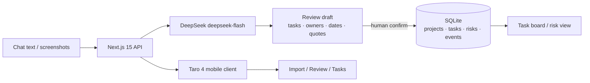

<p align="center">
  
</p>

<h1 align="center">FlowBack · 回响</h1>

<p align="center">
  <strong>把一段聊天，变成可审核、可执行、可追溯的任务。</strong><br/>
  <sub>从噪声到行动，人始终在回路中。</sub>
</p>

<p align="center">
  
  
  
  
  
  
  
</p>

<p align="center">
  <strong>中文</strong> ·
  <a href="README.en.md">English</a> ·
  <a href="README.ja.md">日本語</a>
</p>

---

> **聊天结束的地方，就是工作开始的地方。**
>
> FlowBack 读取聊天文字或聊天截图，抽取任务、负责人、截止时间与逐字引用。AI 的产出先进入审核台，**人确认之后才写入数据库**；系统同时指出责任空缺、时间倒挂、截止日期缺失和未确认的决策。

这不是一个“把聊天总结一下”的 Demo。它是一条完整的、可审计的工作流：

```text
聊天  →  AI 草稿  →  人工审核  →  任务  →  状态
        只生成候选      你来决定      SQLite     刷新仍存在
```

### 为什么是 FlowBack

| 普通 AI 摘要 | FlowBack |
|---|---|
| 输出一段看起来合理的文字 | 输出带来源引用的任务对象 |
| 直接覆盖或写入数据 | 只生成候选，确认后才入库 |
| 漏掉“没人负责”这类空白 | 把责任空缺、时间冲突、未确认决策变成可见风险 |
| 刷新即消失的演示状态 | SQLite + task events，刷新后状态仍然存在 |
| 只能在一个页面里看 | Next.js 管理端 + Taro 移动端，共用同一套 API |

### 真实证据，而不是状态文案

| 证据 | 结果 |
|---|---|
| DeepSeek 真实调用 | `deepseek-flash`，思考模式关闭，JSON 输出，服务端 Key |
| R2 真实验收 | 7 / 7 组夹具通过；任务召回、精确率、F1 **100%**；引用核验 **100%** |
| 回归测试 | **11 个测试文件 / 78 tests** 通过 |
| 移动端真实链路 | 截图导入 → DeepSeek → 审核修改 → 确认 → 任务完成 → 刷新持久化 |
| 微信小程序 | `build:weapp` 构建通过；**原生真机仍待完成**（AppID / HTTPS 域名未配置） |
| R4 影像 | 45s 主片 + 15s 纯字体片，均已实际渲染并通过 FFprobe |

> [!IMPORTANT]
> **边界必须说清楚：** 视频和 README 中的移动端画面来自 **Taro H5 预览与真实服务链路**，不是微信原生真机录屏。H5 截图不能替代微信真机证据；R3 的微信体验版仍待完成。

### 产品，四个动作

<table>
<tr>
<td width="25%" valign="top"><strong>01 · 导入</strong><br/><sub>把混乱带进来</sub><br/><br/>上传最多 4 张截图，或粘贴聊天文字。截图只用于本次整理，删除项目会一起删除。</td>
<td width="25%" valign="top"><strong>02 · 草稿</strong><br/><sub>让模型先做脏活</sub><br/><br/>DeepSeek 抽取任务、负责人、日期与原文引用；没有原文依据的字段会被降级或标为待确认。</td>
<td width="25%" valign="top"><strong>03 · 审核</strong><br/><sub>人保留最后决定权</sub><br/><br/>逐条修改负责人/日期/状态。时间倒挂、无人负责、未确认决策都在这里出现。</td>
<td width="25%" valign="top"><strong>04 · 执行</strong><br/><sub>确认之后才发生</sub><br/><br/>任务进入 SQLite 看板；勾选完成、解决/重开风险，刷新后状态仍在。</td>
</tr>
</table>

### 界面

<p align="center">
  <em>Taro H5 预览 · 390px · 真实截图导入与审核数据</em>
</p>

<table align="center">
<tr>
<td align="center"><br/><sub><b>导入</b><br/>截图 / 文字</sub></td>
<td align="center"><br/><sub><b>审核</b><br/>任务 · 负责人 · 日期</sub></td>
<td align="center"><br/><sub><b>来源与风险</b><br/>逐字引用 · 时间冲突</sub></td>
<td align="center"><br/><sub><b>任务</b><br/>完成 · 持久化</sub></td>
</tr>
</table>

<p align="center"><sub>H5 预览，不是微信原生真机录屏。真机验证仍需 AppID 与可信 HTTPS 域名。</sub></p>

### R4 影像

**FlowBack — From Noise to Action** · 45 秒 · 1920×1080 · 30fps · H.264/AAC

[](videos/r4/FlowBack_Demo_45s.mp4)

[▶ 播放 / 下载 45s 主片](videos/r4/FlowBack_Demo_45s.mp4) · [完整制作报告](videos/r4/R4-PRODUCTION-REPORT.md) · [分镜表](videos/r4/storyboard/storyboard.md)

**CHAOS → ORDER** · 15 秒 · 纯字体 / 程序化动态图形 · 1920×1080 · 30fps

[](videos/r4/FlowBack_Typography_15s.mp4)

[▶ 播放 / 下载 15s 字体片](videos/r4/FlowBack_Typography_15s.mp4)

两条片子使用同一套视觉系统：暖白、石墨黑、信号绿、少量橙色。45s 主片把真实 H5 流程嵌入手机构图；15s 字体片由 RuiC 程序化渲染，中文品牌字与 `FlowBack` 均为精确字体排版，不依赖视频模型猜字形。

### 其他影像

**动态字体重构** · 15.08 秒 · 2560×1440 · 24fps · H.264/AAC

<a href="videos/动态字体重构.mp4"></a>

[▶ 播放 / 下载《动态字体重构》](videos/动态字体重构.mp4)

桌面提供的额外动态字体作品，保留原始文件名；不计入 R4 两支成片的规格与验收。

### 架构



- **后端**：Next.js 15 App Router + TypeScript strict + Zod + `node:sqlite`。
- **移动端**：Taro 4 + React 18 + TypeScript，底部只有 **导入 / 任务** 两个入口。
- **身份**：Bearer session，数据库只存 SHA-256 hash；项目/来源/任务/风险/截图全部做 owner 校验。
- **安全**：DeepSeek Key 只在服务端；`FLOWBACK_LOCAL_TOKEN` HttpOnly cookie；上传截图访问鉴权；日志脱敏 Bearer / code / openid / 图片 data URL。
- **数据**：`projects / sources / extractions / tasks / risks / task_events / users / sessions`；项目删除级联清理数据库和截图目录。

### 快速开始

```bash
git clone https://github.com/YanKaFei/flowback.git
cd flowback
npm install
cp .env.example .env.local
# 在 .env.local 中填写：
# DEEPSEEK_API_KEY=...
# FLOWBACK_LOCAL_TOKEN=<openssl rand -base64 32>
# FLOWBACK_DEV_AUTH=1   # 仅本机开发
npm run dev
```

打开 <http://127.0.0.1:4317>。

```bash
npm run check      # lint + typecheck + 78 tests + production build
```

没有 `DEEPSEEK_API_KEY` 时，应用进入**明确标记的示例模式**，不会把规则结果伪装成 AI 输出。

### 微信小程序

```bash
cd miniapp
npm install
npm run build:weapp     # 生成 dist/，约 432 KB
npm run dev:h5          # 4318，仅移动端浏览器预览
```

当前状态：

| 项 | 状态 |
|---|---|
| 真实 DeepSeek + H5 闭环 | **通过** |
| 微信 `build:weapp` | **通过** |
| 微信原生真机 | **待完成** — 无 AppID / 可信 HTTPS / request 合法域名 |
| 体验版分享 | **未就绪** |

外部步骤：配置 `WECHAT_APP_ID` / `WECHAT_APP_SECRET`；部署可信 HTTPS；把域名加入微信 request 合法域名；完成隐私保护指引；微信开发者工具真机验收。

### R4 制作说明

| 层 | 使用 |
|---|---|
| 主剪 / 渲染 | **Huashu Motion 0.3.1**：`runtime/om-engine.js` 视频 seek/extract、`OM.music` / `OM.sfx`、`om sound`、`om render` |
| 程序化字体 | **RuiC Motion**：`mg/core.py` 的 `text` / `text_slices` / `text_outline`、`mg/fonts.fit_size`、`mg/dsp` 合成配乐 |
| 动态排版叙事 | **Huashu Art Motion** 的 `y5_kinetic_type` 语法：`slam / rise / marker`、一拍一焦点、色块章节 |
| 素材 | 真实 H5 录屏 + `acceptance/images/07-chat-conflict.png`；无商业音乐、无 H3 生成素材 |
| 许可证 | 三个 Motion 仓库均为 MIT；字体为 OFL 1.1；详见制作报告 |

### 文档

- [R3 微信真机报告](acceptance/R3-WECHAT-DEVICE.md) — 安全、身份隔离、待完成项
- [R2 真实验收](acceptance/REPORT.md) — 7/7 fixtures、引用核验、真实调用
- [R4 制作报告](videos/r4/R4-PRODUCTION-REPORT.md) — 工具、代码、FFprobe、QA
- [移动端验收](acceptance/MOBILE-FINAL.md)
- [小程序说明](miniapp/README.md)

### 一句话

**AI 可以提出任务；只有人可以决定它是否成为工作。**

## 致谢与许可

- **Huashu Motion** — MIT · [github.com/alchaincyf/huashu-motion](https://github.com/alchaincyf/huashu-motion)
- **RuiC Motion** — MIT · [github.com/HRuiCcc/RuiC-motion-reel](https://github.com/HRuiCcc/RuiC-motion-reel)
- **Huashu Art Motion** — MIT · [github.com/alchaincyf/huashu-art-motion](https://github.com/alchaincyf/huashu-art-motion)
- 随包拉丁 / 中文字体 — SIL OFL 1.1，具体见各源码目录。
- FlowBack 产品截图与 H5 录屏来自本项目；微信原生状态已在上方说明。

<p align="center">
  <sub>基于 <strong>DeepSeek Harness</strong> 构建 · deepseek-flash · Next.js · Taro · SQLite</sub><br/>
  <sub>噪声 → 结构 → 行动</sub>
</p>
