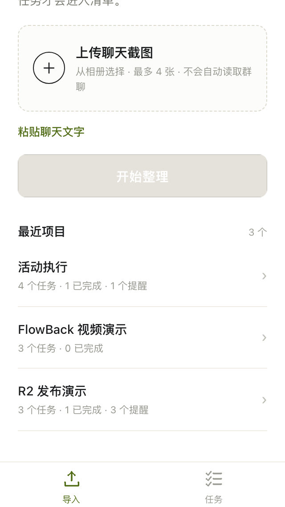

# Mobile screenshots

这些截图来自 **Taro H5 预览**（与小程序共用同一套 Taro 页面），用 Puppeteer 在 320 / 375 / 390 / 430px 下渲染。它们用于检查移动端视觉与布局，**不代表微信真机截图**；原生 `weapp` 构建另见 `miniapp/dist/`。

## 导入

| 320 top | 320 bottom | 375 |
| --- | --- | --- |
|  |  |  |

| 390 | 430 | 选择截图后 |
| --- | --- | --- |
|  |  |  |

## 审核

| 320 top | 320 bottom | 375 |
| --- | --- | --- |
|  |  |  |

| 390 | 430 | 来源与风险展开 |
| --- | --- | --- |
|  |  |  |

## 任务

| 320 top | 320 bottom | 375 |
| --- | --- | --- |
|  |  |  |

| 390 | 430 |
| --- | --- |
|  |  |

| 任务编辑 | 风险详情 | 已解决 / 重开 |
| --- | --- | --- |
|  |  |  |

项目级风险（非任务关联）同样在任务页内联展示并可打开处理：

## 真实截图导入闭环

## 尺寸检查

- 所有页面在 320/375/390/430 下 `scrollWidth === innerWidth`，无横向溢出。
- 320px 下导入、审核、任务内容分别在 Taro 页面容器内纵向滚动；固定底栏保持可见。
- 375/390/430 下当前内容完整呈现在首屏内。
- 320/375/390/430 的主截图均包含底部安全区留白；真机安全区与键盘仍需真机验证。
- 机器可读结果：`viewport-check.json`。

## R3 认证 / 隐私

`r3-import-auth-375.png` 和 `r3-import-upload-auth-375.png` 是加入最小身份与截图隐私提示后的 Taro H5 预览，仍不是微信真机截图。R3 真机状态见 `../../acceptance/R3-WECHAT-DEVICE.md`。
